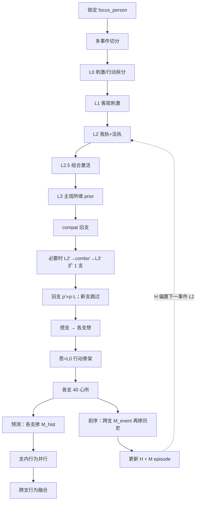

# 执行流程说明

`MentalWorldModel.evaluate_from_yuanwen()` 当前路径（多认知分支）。  
相关：[数据流](data_flow.md) · [架构](architecture.md) · [概念](concepts.md)

---

## 一、总览

**入口**：`evaluate_from_yuanwen(yuanwen, llm, focus_person=…)`  
**默认报告**：`to_event_report_dict()` → `reports/*.json`

---

## 二、分析对象

| 来源 | 优先级 |
|------|--------|
| CLI `--focus-person` / API `focus_person` | 高 |
| 原文 `分析对象：某某`（及同类写法） | 次 |

一次评估只建模此人；提示词强制禁止改写成他人内心。多事件全程同一 `focus_person`，并写入连续性 `person_id`。

---

## 三、多事件路由

原文匹配 `事件1：` / `事件2：` …（≥2 件）：

| 事件 | `use_action_feedback` | 心所连续性 | 行为 |
|------|----------------------|------------|------|
| 前序 | True（拆行动、打 L、写思） | 跨支融成 `M_event`，再掺历史作报告；**落库 `M_event`** | 否 |
| 末事件 | False（后验=先验，思空） | 各支掺同一 `M_hist`；**不做跨支心所融合** | 支内并行预测，再跨支融合行为 |

前言（首个「事件」标签前，含分析对象行）进入各事件 `role_context` 背景。

---

## 四、感知层（刺激侧，不见行动造作）

| 步 | 做什么 | 输出 |
|----|--------|------|
| L0 | 拆 `stimulus_text` / `action_span` / `action_description` | 刺激与行动隔离 |
| L1 | 客观刺激结构 | actors / action / scene… |
| L2 | 我执 + 法执假设 | 开放列表 |
| L2.5 | 组合激活去重视角 | `grasping_combos` |
| L3 | 按组合渲染所缘 text；prior = P(C) | `subjective_alambanas` |

感知输入只用刺激文本；常规 L2–L3 **不见行动造作**。若后续判定需扩支，再走 **行动条件下的感知子路径**（见 5.1）。

---

## 五、认知层

### 5.1 行动更新（解释事件）

有行动时顺序为：**compat（旧支）→ 必要时扩支 → 旧支后验 → 搭支 → 各支想**。想不吃后验概率；屏障后再开心所。compat 与想 **不再并行**（扩支可能改变支集合）。

**旧支（刺激侧生成）：**

1. 对各已有所缘打 **compat**（LLM `likelihood`）
2. **L** 不对称：`a_proxy=normalize(prior)`；
   - compat≥0.5：`h=0.5+0.5·a`（支持侧）
   - compat<0.5：`h=0.25+0.25·a`（矛盾侧少压）
   - `L=1+h·(compat−1)`
3. **p'** ∝ p · L → `posterior`（仅 `action_informed=false`）
4. 字段：`action_compat`=raw，`action_likelihood`=有效 L

**扩支（`max(compat) < 0.45` 且支数 `< 4` 才触发）：**

行动对旧假设是后验证据；对新假设是**生成条件**，同一行动不再二次当似然。

1. L2'：客观所缘 + 行动骨架 → 新我执/法执（写入感知池）
2. combo'：枚举组合、按行动解释度打 alignment，去同视角后取 Top-1（`C_act*`）
3. L3'：按该组合渲染 1 条所缘；`action_informed=true`
4. 新支 prior = 组合激活分，夹到 `[0.08, 0.35]`；**posterior = prior**，compat/L 固定 1.0（不打 compat）
5. 旧支已矫正的 posterior 与新支 prior **混合归一化**

不满足触发条件则不加支。扩支失败保持原集合。

无行动 / 预测事件：`posterior = prior`，compat/L=1；只生成想；**不扩支**。

### 5.2 分支

对每个所缘支：

- **想**：隔离并行（不依赖后验）
- **思**：共享 L0 行动骨架（每事件一次；无行动则空）
- **a**：激活权重 = 归一后的 prior \(P(C)\)（不再乘支置信）；`behavior_contribution` = a
- **支置信**：所缘/想/思几何平均，仅供不确定性估计 / 报告
- **40 心所**：支内评分 + 对治消解
- **行为**（预测事件）：各支先掺历史心所，再**并行**支内 Top-3；然后跨支融合 Top-K（默认 5）

行为融合：`P(A) = Σ a_i · P(A|i)`（预测不算 L）。支间并行不影响该式。

### 5.3 连续性

- **认知 H**：压缩所缘+想+后验等，偏置下一事件 L2（不改感知公式，只注入解释倾向）
- **心理 M**：历史 episode 按 θ（可选×叙事时间衰减）加权平均得 `M_hist`，再按相关度 λ 掺进当前心所
  - 前序：`M_final = (1-λ) M_event + λ M_hist`；**落库只存未掺历史的跨支 `M_event`**
  - 预测：同一 `M_hist/λ` 写入各支 `mental_factor_scores_final`，再预测行为；顶层不做跨支心所 final

---

## 六、报告字段（默认）

按流水线，每事件一份：

`focus_person` → `yuanwen` → `stimulus_action_split` → `objective_event` → `self/dharma_grasping` → `grasping_combos` → `subjective_alambanas`（含 prior/posterior/compat/L/`action_informed`）→ `action_evidence` → `branches`（a/所缘/想/思/心所/行为）→ `aggregated_behaviors`（预测）→ `mental_factors_event_nonzero` → 前序另有 `mental_factors_final_nonzero`；预测为 `mental_report_mode=per_branch_only` → `continuity` → `notes`

详见 [report.md](report.md)。

`--verbose` 才展开完整调试树。

---

## 七、心所评分（支内）

四列权重：所缘境 0.35 · 生起念头 0.30 · 业 0.10 · 现代心理学 0.25。  
门控与合成见评分管线实现；种子库默认关（`SEED_LIBRARY_ENABLED`）。

---

## 八、相关常量（摘录）

| 常量 | 位置 | 含义 |
|------|------|------|
| `BRANCH_ACTION_TOP_K=3` | `perception/config.py` | 支内行为条数 |
| `AGGREGATED_ACTION_TOP_K=5` | 同上 | 跨支融合条数 |
| `MAX_ALAMBANA_BRANCHES` | 同上 | 常规感知所缘支上限（3） |
| `ACTION_EXPAND_MAX_BRANCHES=4` | 同上 | 含行动扩支后的支数上限 |
| `ACTION_EXPAND_MAX_COMPAT=0.45` | 同上 | 低于此才尝试扩支 |
| `ACTION_EXPAND_MIN/MAX_NEW_PRIOR` | 同上 | 新支 prior 夹紧 0.08～0.35 |
| `MENTAL_LAMBDA0=0.30` / `MENTAL_LAMBDA_MAX=0.50` | `continuity/config.py` | M 融合强度 |
| `MENTAL_MAX_EPISODES=20` | 同上 | 历史 episode 条数上限 |
